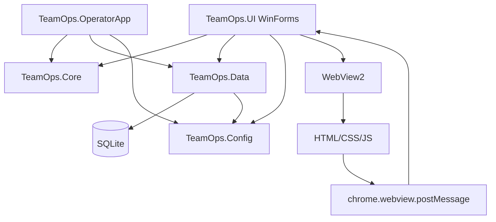
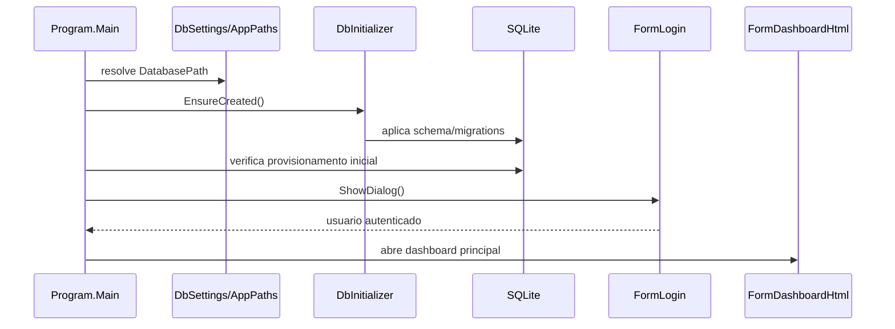
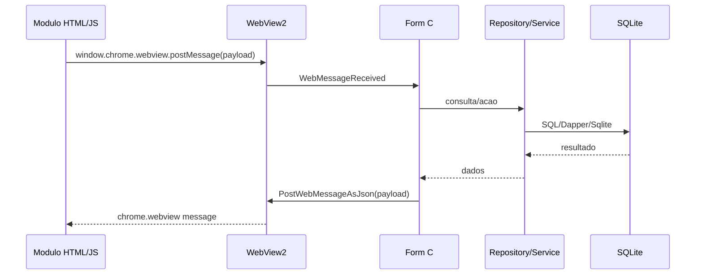

# Arquitetura

## Visao geral

TeamOps segue uma separacao em camadas simples:



## Projetos da solution

### TeamOps.UI

Aplicacao principal. Contem o dashboard WinForms/WebView2, forms tradicionais e modulos HTML em `TeamOps.UI/ui`.

Responsabilidades:

- Login e abertura do dashboard.
- Controle de acesso pela matriz central de permissoes e escopo organizacional.
- Hospedagem dos modulos HTML via WebView2.
- Integracao com repositorios e servicos.
- Importacao/exportacao de arquivos operacionais.
- Abertura de formularios de operacao, relatorio e administracao.

### TeamOps.OperatorApp

Aplicacao WinForms separada para leitura de Hikitsugui por operador. Usa WebView2, os mesmos projetos Core/Data/Config e o caminho `HikitsuguiAttachmentPath`.

### TeamOps.Core

Camada de dominio. Contem entidades como `Operator`, `User`, `Shift`, `FollowUp`, `Hikitsugui`, `PR`, `CL`, `MachineEvent`, `OperatorPresence`, `Task` e validadores.

### TeamOps.Data

Camada de persistencia. Contem:

- `SqliteConnectionFactory`.
- `DbInitializer` e `DbSeeder`.
- Repositorios por agregado/tabela.
- SQL externo em `Sql/Hikitsugui`, `Sql/paidleave` e `Sql/presence`.
- Migrations versionadas do Schema V2, incluindo producao, topologia Haidai, capacidades setoriais e integridade de seguranca.

### TeamOps.Config

Centraliza resolucao de caminhos. `AppPaths.GetDatabasePath` resolve o SQLite local. `StoragePathResolver` resolve documentos e integracoes dentro de `StorageRoot`, aceita UNC, rejeita unidades de rede mapeadas e impede que caminhos relativos escapem da raiz.

## Inicializacao



## Configuracao e caminhos

O `TeamOps.UI/App.config` define `StorageRoot` como raiz dos documentos e integracoes. Caminhos relativos sao resolvidos dentro dessa raiz:

- `StorageRoot`: `C:\TeamOps` no desenvolvimento ou `\\servidor\compartilhamento\TeamOps` em producao
- `DatabasePath`: `C:\TeamOps\DB\teamops.db`
- `PRDirectory`: `PR`
- `PRTemplate`: `Modelos\ModeloPR.xlsx`
- `CLDirectory`: `CL`
- `CLTemplate`: `Modelos\ModeloCL.xlsx`
- `HikitsuguiAttachmentPath`: `Anexo\Hikitsugui`
- `OperatorScheduleDirectory`: `Schedule`
- `HaidaiExportDirectory`: `Haidai`
- `ProductionEventsDirectory`: `Production\Events`
- `ProductionSourceEventsDirectory`: `Production\Source\Events`
- `ProductionSourceDatDirectory`: `Production\Source\Dat`
- `ProductionImportBatchPath`: `Production\import-production.bat`
- `ProductionImportCompletionFile`: `Production\import.done`
- `ProductionImportTimeoutSeconds`: `180`

`DatabasePath` e independente de `StorageRoot` e permanece local. Em producao, usar UNC para `StorageRoot`; unidades mapeadas sao rejeitadas. Caminhos relativos nao podem escapar da raiz usando `..`.

## WebView2 e modulos HTML

Os forms HTML chamam `EnsureCoreWebView2Async`, configuram `SetVirtualHostNameToFolderMapping("app", ...)` e navegam para `https://app/index.html`. Os arquivos HTML sao copiados para o output via `TeamOps.UI.csproj`.

Fluxo padrao:



## Forms e modulos HTML

Modulos HTML principais identificados:

- `ui/dashboard`
- `ui/access-control`
- `ui/admin`
- `ui/follow-chart`
- `ui/follow-up`
- `ui/follow-operator-report`
- `ui/follow-report`
- `ui/follow-single-report`
- `ui/hikitsugui-create`
- `ui/hikitsugui-leader-read`
- `ui/hikitsugui-reader`
- `ui/mastercard`
- `ui/mastercard-report`
- `ui/haidai`
- `ui/operators`
- `ui/operator-manager-report`
- `ui/production-monitor`
- `ui/paidleave`
- `ui/reports`
- `ui/presence`
- `ui/presence-layout`
- `ui/sobra-de-peca`
- `ui/tasks`
- `ui/tasks-report`

O dashboard abre os modulos por mensagens `open:*`, por exemplo `open:operadores`, `open:relatorios`, `open:presence`, `open:haidai`, `open:followup`, `open:tasks`, `open:mastercard`, `open:production`, `open:hikitsugui`, `open:hikitsugui_read`, `open:sobradepeca`, `open:pr`, `open:cl`, `open:yukyu`, `open:admin` e `open:accesscontrol`.

## Controle de acesso

A fonte de verdade e o Schema V2: perfis hierarquicos, `ModulePermissions`, referencia na arvore e atribuicoes explicitas de setor. A camada de autorizacao combina permissao funcional e escopo organizacional em cada operacao protegida. Nao existe coluna ou comparacao legada de `AccessLevel`.

`SessionVersion` permite revogar sessoes apos mudanca de senha ou acesso. O dashboard valida a versao autenticada periodicamente e antes de processar comandos.

## Banco de dados

O banco usa SQLite com connection string:

```text
Data Source=<DatabasePath>;Mode=ReadWriteCreate;Pooling=True;Default Timeout=30
```

O schema inclui tabelas para operadores, turnos, grupos, setores, usuarios, locais, follow-up, Hikitsugui, anexos, PR, CL, maquinas, eventos de maquina, paid leave, presenca, agenda de operadores, logs, tarefas e historico de tarefas.

Repositorios usam `SqliteConnectionFactory` e Dapper ou comandos `Microsoft.Data.Sqlite`.

## Migrations e schema

`InitialSchema.sql` cria as tabelas operacionais base. As migrations `V2_*` evoluem organizacao, identidade, audiencias, escopos, modulos operacionais, monitor de producao, topologia Haidai, capacidades setoriais e restricoes de integridade. `DbInitializer` aplica cada versao uma unica vez e valida as chaves estrangeiras ao terminar.

`SectorCapabilities` associa processos operacionais a setores por ID. Dessa forma, importadores, forecast e Sobra de Peca preservam suas regras especificas sem depender do codigo ou do ID historico do setor. As associacoes sao mantidas em **Admin > Processos por Setor**.

## Dependencias externas

- Microsoft Edge WebView2 Runtime.
- Acesso ao caminho do banco SQLite.
- Pastas configuradas em `App.config`.
- Templates Excel para PR/CL.
- Arquivos CSV de agenda de operadores.
- Arquivos TXT e DAT de producao.
- BAT de importacao de producao, quando configurado.
- Permissoes de leitura/escrita nas pastas operacionais.
